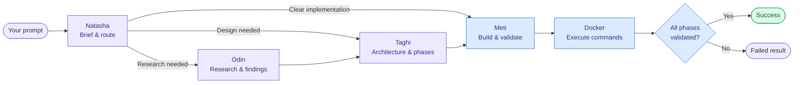
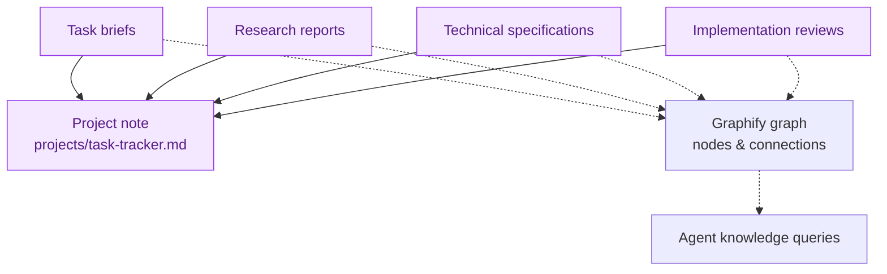

<div align="center">

# AP-V2 · Agent Platform

### One prompt. Four agent roles. A connected knowledge trail.

Turn engineering requests into structured briefs, research, phased specifications, and validated implementations.


[Quick start](#quick-start) · [Workflow](#how-the-workflow-runs) · [Project memory](#keep-related-tasks-connected) · [Repository](#repository-map)

</div>

---

AP-V2 is a Python CLI that coordinates an engineering team built with Pydantic AI. Natasha selects the entry point for each request; Odin researches, Taghi designs, and Meti implements through Docker commands. Each stage saves Markdown artifacts to a local vault, with Graphify providing graph lookup when extraction is available.

## How the workflow runs



- **Natasha — coordinator:** produces a typed task brief and chooses the next lead. Can query existing vault nodes and connections.
- **Odin — researcher:** uses vault context to produce findings and a recommended stack. The current agent has vault tools; no dedicated web-search tool is registered.
- **Taghi — architect:** produces an architecture overview, dependencies, and ordered execution phases with explicit validation commands.
- **Meti — implementer:** writes code through Docker commands and validates phases in order. A reported success is downgraded to failure if any phase remains unvalidated.

Agents run sequentially along the selected route. Research requests continue through design and implementation; design requests continue through implementation.

## Quick start

### 1. Prepare the environment

You need **Python 3.10+**, **Docker installed and running**, and a ChatGPT account with access to the configured model through the provider's sign-in flow. Network access is needed for authentication, model calls, and image or dependency downloads. Obsidian is optional for viewing notes.

From the repository root:

```bash
python3 -m venv .venv
source .venv/bin/activate
python -m pip install -e .
docker info
```

On Windows, activate the environment with `.venv\Scripts\Activate.ps1` in PowerShell.

### 2. Configure the model (optional)

The CLI loads `.env` automatically. These are the settings read by the authentication helper, shown with their current code defaults:

```dotenv
OPENAI_MODEL=gpt-6.1-sol
CHATGPT_AUTH_FILE=.env.chatgpt-auth.json
```

Relative credential paths resolve from the repository root; `~` is expanded. The CLI uses ChatGPT OAuth through Pydantic AI. On the first run, open the printed authorization URL and complete sign-in. Credentials are saved locally for reuse. The default credential filename is covered by `.gitignore`; keep any custom credential file out of version control too.

### 3. Give the team a task

```bash
python main.py "Build a compound interest calculator" --project my-awesome-app
```

For a standalone task, omit the project:

```bash
python main.py "Create a small CSV validation utility with tests"
```

Run commands from the repository root so `./vault` and `./workspace` resolve correctly. Inspect the CLI without starting a workflow:

```bash
python main.py --help
```

The first sandbox command pulls `node:18-bullseye-slim` if it is missing locally. Generated files live in `workspace/<task_id>/`; implementation summaries and phase results are saved under `vault/code-reviews/`. A returned failed implementation makes the CLI exit with status `1`.

## Keep related tasks connected

Reuse a project ID across requests:

```bash
python main.py "Design a SQLite-backed task tracker" --project task-tracker
python main.py "Build a CSV import utility for a task tracker" --project task-tracker
```

AP-V2 creates `vault/projects/task-tracker.md` if needed and preserves existing project-note content. Produced briefs, reports, specifications, and implementation reviews include a visible project link and frontmatter:

```yaml
project: "[[projects/task-tracker]]"
```

Project IDs accept letters, digits, underscores, and hyphens, and must start with a letter or digit. Project grouping links the notes; each run still receives a separate task workspace.



Open **`vault/` as an Obsidian vault** to browse the notes and project wikilinks. Those links work independently of Graphify.

Graph updates are attempted after stage artifacts are saved. Graphify Markdown extraction requires its own supported backend; if extraction fails, AP-V2 logs a warning and continues with saved notes. Without a usable graph, knowledge queries may return no context.

## What stays on disk

Each run gets an ID shaped like `task-YYYYMMDD-<slug>-<six-character-id>`.

```text
workspace/<task_id>/                  Generated source, tests, docs, dependencies
vault/
├── tasks/task-temp-brief.md          Routing brief (see limitation below)
├── research/research-<task_id>.md     Research report, when Odin runs
├── specs/spec-<task_id>.md            Specification, when Taghi runs
├── code-reviews/review-<task_id>.md   Implementation summary and validated phases
├── projects/<project_id>.md          Optional shared project note
└── .graphify/graph.json              Knowledge graph, when available
```

Generated workspace files, stage notes, and graph artifacts are ignored by Git. Project notes under `vault/projects/` are **not currently ignored**; review them before committing.

## Execution and validation

- Each command runs in a **fresh Docker container**, with only the task directory mounted at `/app/workspace/<task_id>/`.
- Files in that mount persist across commands. Container-local installs and changes outside it do not; keep durable dependencies in the mounted directory.
- Each phase must pass its **exact validation command**, submitted separately with its phase name, in the declared order. Successful command exit codes are recorded as validation results.
- Straightforward tasks receive a fast-track phase that asks Meti to create and run a task-specific validation script.
- The runner defaults to a **120-second wait timeout** per command and removes the container after execution.

## Repository map

```text
.
├── main.py                    CLI, task IDs, routing, and orchestration
├── agents/
│   ├── natasha.py             Structured briefs and routing
│   ├── odin.py                Research reports
│   ├── taghi.py               Specifications and execution phases
│   └── meti.py                Docker tools and phase validation tracking
├── tools/
│   ├── chatgpt_auth.py        OAuth credential storage and model setup
│   ├── docker_runner.py      Container lifecycle and workspace mounts
│   ├── graphify_tool.py      Graph extraction, node search, and neighbors
│   └── project_notes.py      Project IDs, note creation, and shared links
├── pyproject.toml            Package metadata and runtime dependencies
├── vault/                    Local Markdown knowledge base
└── workspace/                Generated task workspaces
```

## Current limitations

AP-V2 is version **0.1.0**. These details matter when interpreting its output:

- **Routing brief identity:** Natasha writes `task-temp-brief.md` before the orchestrator assigns the final task ID. The saved brief is not renamed or rewritten, so later task-specific brief links may not resolve and subsequent runs overwrite that temporary brief.
- **Container isolation:** network access is enabled, the task directory is writable, and the runner does not configure CPU or memory limits.
- **Runtime availability:** the default container is a Node image. Python and other runtimes are not provisioned by the runner; tasks that need them must arrange installation or use an adapted image.
- **Validation scope:** phase completion reflects command exit codes. It does not independently establish test quality or provide a separate human code review.

<div align="center">

<sub>Built with Python · Pydantic AI · Docker · Markdown · Graphify</sub>

</div>
