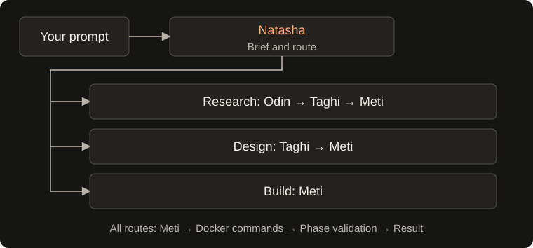
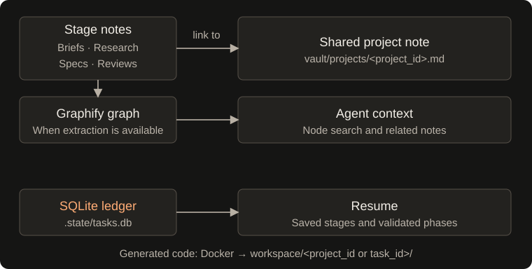
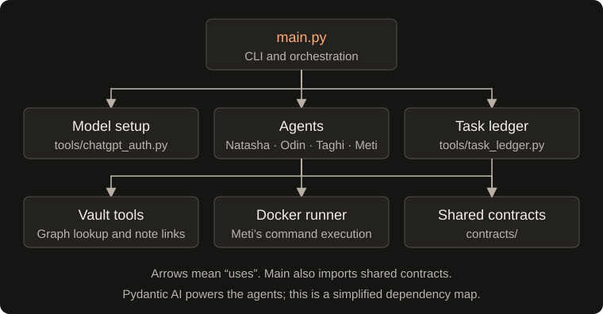

<div align="center">


# BuildRelay

### An AI development team that plans, builds, and checks your code.

Describe your development task. BuildRelay coordinates research, design, implementation, and validation, with saved progress you can resume.


[Website](https://dutch-panda.github.io/BuildRelay/) · [Tests](#testing) · [CI results](https://github.com/Dutch-panda/BuildRelay/actions/workflows/tests.yml) · [Quick start](#quick-start) · [Workflow](#how-the-workflow-runs) · [Resume a task](#resume-a-task) · [Project memory](#keep-related-tasks-connected) · [Components](#component-connections) · [Security](#security-and-isolation-boundaries) · [Repository](#repository-map) · [Troubleshooting](#troubleshooting)

</div>

---

BuildRelay is a Python CLI that coordinates an engineering team built with Pydantic AI. Natasha selects the entry point for each request; Odin researches, Taghi designs, and Meti implements through Docker commands. Each stage saves Markdown artifacts to a local vault, with Graphify providing graph lookup when extraction is available.

## How the workflow runs



- **Natasha — coordinator:** produces a typed task brief, a 5-sentence intent alignment brief, and conducts an interactive Grill-Me interview (up to 10 questions) to clarify goals, entry mechanisms, and edge cases before routing. Prompts with a low-friction clarification wizard, supports mid-way intent pivots, queries existing vault connections, and can look up official library names online.
- **Odin — researcher:** queries vault graph metadata and external web documentation / package registries (PyPI, npm, Tavily API) to produce technical findings and recommended stacks. Research notes record resolved vault notes and external search-result URLs. Tasks marked with `--research` / `--research-only` complete cleanly after Odin without invoking design or implementation.
- **Taghi — architect:** produces an architecture overview, user input surface specification (`input_interface_spec`), dependencies, and ordered execution phases with explicit validation commands. Conducts an architectural grill interview and presents an interactive approval gate before Meti implements. Phases are constrained to actionable sandbox validation; conditional gates or unprovided external credentials are documented in architecture overview notes rather than active execution phases.
- **Meti — implementer:** writes code through Docker commands with live progress spinners and validates phases in order. Generates a workspace `README.md` with run/test instructions, logs execution details to `.state/task.log`, and renders a file tree and `How to Run & Test` banner. A reported success is downgraded to failure if any phase remains unvalidated.

Agents run sequentially along the selected route. Research requests continue through design and implementation; design requests continue through implementation. Research-only tasks complete immediately after Odin.

## Quick start

### 1. Prepare the environment

You need **Python 3.11+**, **Docker installed and running**, and a configured model provider: API credentials, ChatGPT OAuth, or a compatible local model endpoint. Remote providers need network access for authentication and model calls. Web search and image or dependency downloads also require connectivity; a preconfigured local model can avoid remote inference. Obsidian is optional for viewing notes.

Clone the repository if you have not already done so:

```bash
git clone https://github.com/Dutch-panda/BuildRelay.git
cd BuildRelay
```

From the repository root:

```bash
python3 -m venv .venv
source .venv/bin/activate
python -m pip install -e .
docker info
```

On Windows, activate the environment with `.venv\Scripts\Activate.ps1` in PowerShell.

### 2. Configure credentials & providers

BuildRelay provides an interactive setup wizard to configure your preferred LLM provider, models, and execution tiers in seconds.

#### Interactive Setup Wizard (Recommended)

Run the configuration wizard directly at any time:

```bash
python main.py config
# Or using the console script:
buildrelay config
# Or via CLI flag:
python main.py --config
```

If you launch BuildRelay on a fresh machine without credentials, the CLI automatically detects the zero-config state and prompts:
```
⚡ BuildRelay — No AI credentials detected. Launching interactive setup wizard...
```

The wizard guides you through:
1. **Provider Selection:**
   - **ChatGPT Web Auth (Codex / Browser Subscription):** Connects to your ChatGPT Plus/Team subscription without entering an API key; provider access and usage limits still apply. Supports Codex models (`gpt-6.1-sol`, `gpt-6.1`, `gpt-6`, `gpt-5.5`).
   - **OpenAI API:** Direct API key for GPT-4o, GPT-4o-mini, o3-mini, o1.
   - **Anthropic Claude:** Direct API key for Claude 3.7 Sonnet, Claude 3.5 Haiku.
   - **Google Gemini:** Direct API key for Gemini 2.0 Flash, Gemini 2.5 Pro.
   - **Local LLM (Ollama / LocalAI):** Free, local offline models (e.g. `llama3.3`, `qwen2.5-coder` at `http://localhost:11434/v1`).
   - **Custom / OpenRouter Gateway:** OpenRouter or custom OpenAI-compatible proxies.
2. **Masked Input & Validation:**
   - Inputs are masked for security (`password=True`).
   - A short, synchronous reachability check runs for supported providers before saving. Connectivity failures can be treated as skipped checks; setup completion does not prove model access.
3. **Execution Tier Preset:**
   - Sets your default tier: `balanced` (default), `fast`, or `powerful`.
4. **Lead-Specific Model Customization (Optional):**
   - Customize models for individual leads: Natasha (Coordinator), Odin (Researcher), Taghi (Architect), Meti (Implementer).
5. **Safe Atomic Persistence:**
   - Saved directly to `.env` preserving existing comments and settings.
   - Enforces strict `0600` file permissions (owner read/write only).

#### Manual Configuration via `.env` (Alternative)

If you prefer editing `.env` directly:

**Option A: ChatGPT Web Auth (Codex Subscription — No API Key Required)**
```dotenv
OPENAI_MODEL=gpt-6.1-sol
CHATGPT_AUTH_FILE=.env.chatgpt-auth.json
DEFAULT_TIER=balanced
```

**Option B: Standard Direct API Keys**
```dotenv
OPENAI_API_KEY=sk-...
OPENAI_MODEL=gpt-4o
DEFAULT_TIER=balanced

# Or Anthropic:
# ANTHROPIC_API_KEY=sk-ant-...
# ANTHROPIC_MODEL=claude-3-7-sonnet

# Or Gemini:
# GEMINI_API_KEY=AIza...
# GEMINI_MODEL=gemini-2.0-flash

# Optional per-lead overrides:
# MODEL_NATASHA=google:gemini-2.0-flash
# MODEL_ODIN=anthropic:claude-3-5-haiku
# MODEL_TAGHI=openai:gpt-6
# MODEL_METI=openai:gpt-6.1-sol
```

You can also override models at runtime using `--model` (e.g., `--model anthropic:claude-3-7-sonnet`) or per-lead flags (`--model-taghi`, `--model-meti`).

### 3. Give the team a task

```bash
python main.py "Build a compound interest calculator" --project my-awesome-app
```

For a standalone task, omit the project:

```bash
python main.py "Create a small CSV validation utility with tests"
```

To specify or override the Docker sandbox image:

```bash
python main.py "Build a Python utility" --image python:3.11-slim
```

Run commands from the repository root so `./vault` and `./workspace` resolve correctly. Inspect the CLI without starting a workflow:

```bash
python main.py --help
```

The first sandbox command pulls the selected container image (defaulting to `node:18-bullseye-slim` or the configured `DEFAULT_SANDBOX_IMAGE` / `--image`) if it is missing locally. Generated files live in `workspace/<project_id>/` (or `workspace/<task_id>/` for standalone tasks); implementation summaries and phase results are saved under `vault/code-reviews/`. A returned failed implementation makes the CLI exit with status `1`.

## Interactive alignment and execution modes

To eliminate early misunderstandings and prevent wasted model calls, BuildRelay provides an interactive alignment and review pipeline:

1. **Interactive "Grill-Me" Alignment Sessions (Natasha & Taghi):**
   - **Natasha Intent & Scope Grill:** Evaluates the request and conducts a targeted interview (up to 10 questions) exploring operational goals, user entry methods, frequency/triggers, schemas, and operational edge cases.
   - **Taghi Architecture & Schema Grill:** Before finalizing specifications, conducts an interview (up to 10 questions) covering concrete column/field schemas, form layout, component trade-offs, and offline mock strategies.
   - **Ergonomic Terminal Navigation:**
     - Pressing **`[Enter]`** immediately accepts the recommended default.
     - Pressing **`[1, 2...]`** selects a specific numbered option.
     - Pressing **`[c]`** enters custom requirements, or type freeform text directly at the prompt.
     - Pressing **`[a]`** accepts all remaining defaults without interruption.
     - Pressing **`[q]`** cancels execution cleanly.
2. **Natasha's 5-Sentence Intent Brief:**
   - **Goal:** Exactly what is being built.
   - **Features:** Key functionality in scope.
   - **Stack:** Runtime, frameworks, and base Docker image.
   - **Exclusions:** Out-of-scope or deferred requirements.
   - **Next Steps:** Target lead and first deliverable.
3. **Taghi Architectural Review & Approval Gate:**
   - Taghi presents a detailed architecture review card displaying the system design, the concrete user input interface specification (`input_interface_spec`), required dependencies, and ordered phases.
   - Pressing **`[Y/enter]`** approves the architecture and authorizes Meti to begin implementation.
   - Pressing **`[r]`** allows requesting revisions to schemas, fields, or phases, triggering Taghi to regenerate the specification with user feedback.
   - Pressing **`[q]`** aborts before container code generation.
4. **Execution Flags:**
   - **Default interactive:** Runs the alignment interviews and approval gates before initiating research, design, or implementation.
   - **Headless mode (`-y`, `--yes`, `--auto`):** Automatically accepts recommended defaults without terminal prompts; ideal for scripting, background tasks, and CI.
   - **Step-by-step mode (`--step`):** Prompts for confirmation before handing off to each lead (Natasha → Odin/Taghi → Meti). If the user pivots during a step gate, downstream checkpoints in `.state/tasks.db` are safely rolled back and re-routed.
   - **Research-only mode (`--research`, `--research-only`):** Completes immediately after Odin's research report and web citations, without executing Taghi or Meti.
5. **Meti Delivery Confirmation Gate:**
   - Once all implementation phases pass validation, BuildRelay presents an interactive delivery card displaying the workspace deliverables.
   - Highlights detected **User Input Surfaces & Entry Points** (e.g. Setup wizards, Form sync scripts, Web forms, CLI input tools).
   - Pressing **`[Enter]`** or **`[c]`** accepts the delivery and marks the task complete.
   - Pressing **`[r]`** triggers Meti's live **Refinement Loop** to adjust documentation, add visual flowcharts, or generate setup scripts based on user feedback before finalizing.
6. **Mandatory User Input Surface & Entry Point:**
   - Eliminates the "ghost pipeline" trap where an application is built without an interface for entering data.
   - Natasha defines the input surface in the intent brief; Taghi architects a dedicated execution phase and `input_interface_spec` (e.g. auto-created Google Form, web form, or interactive CLI); Meti implements and verifies the concrete entry point.
7. **Two-Tier Verification Architecture:**
   - **Tier 1 (Automated Docker Sandbox):** Meti validates business logic and data mappers inside isolated Docker containers using deterministic local unit tests, fixtures, and mocked service adapters (e.g., mock `SpreadsheetApp`, simulated REST webhooks).
   - **Tier 2 (Guided Live Verification):** Meti generates a live smoke-test script (e.g., `scripts/verify_live.py` or Apps Script `testDirectSync()`) and an interactive **Live Verification Checklist** in `README.md` with numbered instructions for verifying against real accounts, spreadsheets, or cloud endpoints.

## Token usage and cost analytics

BuildRelay tracks exact prompt (input) and completion (output) token consumption across every lead using PydanticAI metrics:

- **Cost Estimation Engine:** Estimates USD costs using a bundled model-rate table (OpenAI, Anthropic, Gemini). Rates and cache discounts are approximations, not provider billing records.
- **Local & Test Models:** Displays `$0.00 (Local)` for Ollama/vLLM and test runs.
- **Inline Badges:** Natasha brief panels and Taghi specification cards display token tallies as each stage finishes (e.g. `Tokens Used: 1,550 (~$0.006)`).
- **Obsidian Vault Reports:** Meti's review notes under `vault/code-reviews/` record full token metrics and costs.
- **Completion Table:** At workflow completion, a styled Rich table summarizes prompt, completion, total tokens, and estimated cost per lead with grand totals.

## Tiered model routing and token optimization

To balance execution speed, reasoning depth, and cost efficiency, BuildRelay provides tiered model routing and context compression:

- **Model Tiers (`--tier`):**
  - **Fast (`--tier fast`):** Routes lightweight, fast models across all leads (`gpt-4o-mini`, `claude-3-5-haiku`, `gemini-2.0-flash`). Ideal for quick scripts, prototyping, and high speed.
  - **Balanced (`--tier balanced` — default):** Pairs fast models for routing (Natasha) and graph search (Odin) with high-reasoning models for architecture (Taghi: `o3-mini`) and implementation (Meti: `gpt-4o` / `claude-3-7-sonnet`).
  - **Powerful (`--tier powerful`):** Assigns top-tier frontier models across all design and execution phases.
- **Lead-Specific Overrides:**
  - Override individual leads via CLI flags: `--model-natasha`, `--model-odin`, `--model-taghi`, `--model-meti`.
  - Scoped overrides take precedence over global `--model` and `--tier`.
- **Model Lineup Approval Gate:**
  - On launch, BuildRelay renders a 2-column model lineup card displaying the active model for each lead, cost tier label, caching status, and estimated budget.
  - Interactive users can press **`[Enter]`** to confirm, **`[c]`** to quickly switch tiers, or **`[q]`** to abort. Auto/headless runs (`-y`/`--auto`) accept automatically.
- **Prompt Prefix Caching:**
  - All agent system prompts, static guidelines, and contracts are stabilized at prompt prefixes.
  - Agents pass `model_settings={"cache": True}`. Actual caching depends on the provider, model, and SDK support; BuildRelay does not guarantee a cache hit or measured latency or cost savings.
  - Cached tokens are detected and discounted in token summary badges and ledger reports.
- **Context Pruning & Compression:**
  - **Markdown Sanitization:** `prune_markdown` strips verbose YAML frontmatter, empty sections, and backlink blocks.
  - **Semantic Graph Pruning:** `prune_graph_context` scores and ranks vault nodes by keyword overlap, passing only the top 3–5 relevant snippets to Odin rather than raw graph dumps.
  - **Docker Log Slicing:** `prune_docker_log` automatically detects failure tracebacks and assertion errors in long build logs, slicing around the error signature to prevent context window dilution during retry loops.

## Web and documentation search with guardrails

Natasha and Odin have documentation search tools; Odin also has package registry lookup:

- **Web Search:** Uses DuckDuckGo HTML search without a search API key, with optional `TAVILY_API_KEY` support. Natasha receives up to two results per lookup; Odin receives up to three.
- **URL Checks:** Rejects non-HTTP(S) URLs, selected local hostnames, and literal private, loopback, link-local, reserved, or multicast IP addresses. These checks do not resolve DNS or revalidate redirects, so they are not a complete SSRF defense. The optional Tavily integration sends a POST request to its search API.
- **Page Extraction Helper:** `tools/web_search.py` includes `fetch_web_page`, which extracts text from HTML and limits extracted content to 3,000 characters by default. This helper is not currently registered as an agent tool: research uses search snippets rather than full page reads. The character cap is not a response-download limit or a precise token cap.
- **Package Registry Lookup:** Odin can query PyPI or npm for a package name and latest release metadata. Registry presence does not establish authenticity, suitability, or safety. On connectivity errors the helper currently returns `exists=True` with a verification-skipped note, and the agent wrapper can label that result verified; independently verify dependencies before use.
- **Search Call Budget:** Odin allows at most **three search calls per research invocation**, including cached lookups. This does not limit Natasha lookups or registry calls. Recorded external sources are search-result URLs, not claim-level citations or evidence of full-page reading.
- **Local Disk Caching:** Successful query results are cached under `.state/search_cache/`. Reuse avoids another search request, but returned snippets still consume model context. There is currently no cache expiry.

## Dynamic progress and project delivery

- **Live Progress Spinners:** Active Docker operations and LLM generation phases display animated Rich status spinners (`rich.status.Status`) instead of terminal dumps.
- **Clean Execution Logs:** Docker stdout and stderr are routed to `.state/task.log`. Set `BUILDRELAY_DEBUG=1` to echo full container outputs directly to the terminal.
- **Meti Delivery Confirmation Gate:** Pauses after phase checks pass to present an interactive delivery summary, file tree, and quickstart commands, letting users accept (`[Enter]`/`[c]`) or request follow-up refinements (`[r]`) in a live loop before closing the task.
- **User-First Deliverables Mandate:** System prompts mandate beginner-friendly READMEs with visual architecture/dataflow diagrams, zero-jargon quickstarts, and zero-dependency interactive setup scripts (`scripts/setup.js`) to eliminate configuration friction.
- **Auto-Generated Workspace README:** Meti creates a fallback `README.md` in the project or standalone task workspace when one is missing or empty, with architecture, run, and validation guidance. Existing nonempty READMEs are preserved; review the instructions against the generated project.
- **Workspace File Tree:** Renders a clean `rich.tree.Tree` showing generated project files while filtering noisy build artifacts (`__pycache__`, `.git`, `.venv`).
- **How to Run & Test Banner:** Displays prominent quickstart commands based on the detected project stack (e.g. Python, Node.js, Rust, Go).

## Resume a task

The CLI creates a permanent task ID before routing and prints it for later use. Each run is saved in a local SQLite ledger at `.state/tasks.db`. If a workflow fails or is interrupted, resume it from the same repository root:

```bash
python main.py --resume task-build-csv-validator-20261024
```

Replace the example ID with the one printed by your run. Resume reuses the saved prompt, project ID, stage outputs, and workspace. Do not supply a new prompt or `--project` together with `--resume`.

The ledger tracks `PENDING`, `RESEARCHING`, `ARCHITECTING`, `IMPLEMENTING`, `COMPLETED`, and `FAILED`. Completed routing, research, and specification outputs are reused. During implementation, validated phases are skipped and prior validation history is retained. A resumed task that proceeds to execution starts a new numbered run with a fresh three-attempt budget for unfinished phases. A completed task returns without calling a model or rerunning agents.

Command checkpoints are saved before execution and after results are recorded. If interruption happens between those points, the CLI reports the command's outcome as unknown. Inspect the workspace and any external side effects before resuming; a container may still be running after an abrupt process exit. An unfinished command or stage may execute again. Resume does **not** guarantee exactly-once execution or restore the entire model conversation; Meti receives the saved plan, validation history, and interrupted-command information in a fresh conversation.

Back up `.state/`, the corresponding task workspace, and `vault/` together when no workflow is running. Git does not back up the ignored ledger, workspaces, or generated notes. The ledger stores prompts, structured stage outputs, and validation logs locally; it does not replace the generated workspace or vault files. A missing workspace after implementation has begun causes resume to fail rather than silently discard saved work. Only tasks created with the ledger can be resumed; older vault artifacts are not imported automatically. Local per-task locks prevent concurrent CLI runs of the same task and release when the process exits. Unknown IDs and unreadable checkpoints fail explicitly.

## Keep related tasks connected

Reuse a project ID across requests:

```bash
python main.py "Design a SQLite-backed task tracker" --project task-tracker
python main.py "Build a CSV import utility for a task tracker" --project task-tracker
```

### Interactive Project REPL Session

Launch a persistent, conversational engineering session within any project workspace:

```bash
# Launch interactive REPL session
python main.py session task-tracker
# Or using the console script:
buildrelay session task-tracker
```

Inside the interactive session, BuildRelay preserves context across tasks without re-asking questions:
- **`/profile`**: View the active data schemas, form fields, and architectural rules in `workspace/<project_id>/PROJECT_PROFILE.md`.
- **`/env`**: Inspect or configure project-specific credentials (e.g. `SPREADSHEET_ID`, `WEBHOOK_URL`) stored safely in gitignored `workspace/<project_id>/.env`.
- **`/test`**: Run local unit tests and Tier 2 live verification smoke tests within the workspace.
- **`<prompt>`**: Type any feature request, revision, or bugfix to immediately plan, build, and check code in the project workspace with shared memory.

### Project Memory on Disk (`PROJECT_PROFILE.md` & Local `.env`)

BuildRelay creates `vault/projects/<project_id>.md` and initializes `workspace/<project_id>/`:
- **`PROJECT_PROFILE.md`**: Living specification recording active data schemas, input surfaces, architectural rules, and task history. Natasha and Taghi automatically load this memory into prompt context, preventing schema drift across iterations.
- **`.env` (mode `0600`)**: Dedicated project secrets file, automatically gitignored.
- Produced briefs, reports, specifications, and implementation reviews include a visible project link and frontmatter:

```yaml
project: "[[projects/task-tracker]]"
```

Project IDs accept letters, digits, underscores, and hyphens, and must start with a letter or digit. Project grouping links the notes and codebases: tasks sharing a project ID share the same workspace (`workspace/<project_id>/`), allowing successive tasks to build upon existing project modules and tests. Resumed runs reuse that task's workspace. Standalone tasks without a project ID use `workspace/<task_id>/`.



Open **`vault/` as an Obsidian vault** to browse the notes and project wikilinks. Those links work independently of Graphify.

Graph updates are attempted after stage artifacts are saved. Graphify Markdown extraction requires its own supported backend; if extraction fails, BuildRelay logs a warning and continues with saved notes. Without a usable graph, knowledge queries may return no context.

### Research source references

Odin records nodes retrieved from its initial task lookup and its search and neighbor-query tools. Search matches node IDs, labels, source-file paths, and properties. Each saved research report includes a **Related vault sources** section with relative Markdown links and corresponding wikilinks in its `links` frontmatter.

Source paths come from Graphify's `source_file` metadata, including that field inside `properties` when present. Only existing Markdown files inside the vault are listed; duplicate paths are removed, and missing files or paths outside the vault are omitted. The returned `ResearchReport.vault_sources` contains the same vault-relative paths, overriding any model-generated list.

These references identify retrieved graph context. They do not establish that the full source notes were read or that each finding is supported by a particular note. If no source files can be resolved, the report states that explicitly. Graph extraction still requires a working Graphify backend.

## What stays on disk

Each new task gets a permanent ID shaped like `task-<prompt-slug>-YYYYMMDD` (e.g. `task-build-csv-validator-20261026`). The slug is derived from the prompt before any model call; resume keeps the same ID.

```text
.state/tasks.db                      Local workflow ledger and checkpoints
.state/<task_id>.lock                Local process lock file (may remain after exit)
.state/task.log                      Shared execution log
.state/search_cache/                 Cached web search results (no expiry)
workspace/<project_or_task_id>/       Generated source, tests, docs, dependencies
vault/
├── tasks/<task_id>-brief.md          Routing brief with the permanent task ID
├── research/research-<task_id>.md     Research report, when Odin runs
├── specs/spec-<task_id>.md            Specification, when Taghi runs
├── code-reviews/review-<task_id>.md   Implementation summary and validated phases
├── projects/<project_id>.md          Optional shared project note
└── .graphify/graph.json              Knowledge graph, when available
```

The local `.state/` directory, generated workspace files, stage notes, and graph artifacts are ignored by Git. Project notes under `vault/projects/` are **not currently ignored**; review them before committing.

## Execution and validation

- Each command runs in a **fresh Docker container**, with the project or task workspace mounted at `/app/workspace/<task_id>/`.
- Files in that mount persist across commands. Container-local installs and changes outside it do not; keep durable dependencies in the mounted directory.
- Each phase must pass its **exact validation command**, submitted separately with its phase name, in the declared order. Successful command exit codes are recorded as validation results.
- Failed phase validation returns combined stdout/stderr to Meti with the remaining attempt count. Meti can repair and rerun the same check, up to **three validation attempts per phase per run** (one initial attempt and two retries). The third failure stops execution before more sandbox commands or later phases.
- Straightforward tasks receive a fast-track phase that asks Meti to create and run a task-specific validation script.
- The runner defaults to a **120-second wait timeout** per command and removes the container after execution.

### Recovery and attempt history

When a validation command fails, Meti receives its output and can issue repair commands before retrying that phase. Rejected calls with the wrong phase or validation command do not consume an attempt. Running an exact declared validation command without its phase name is rejected. Repair commands are separate from the three-attempt validation budget.

If the model returns a final response while a failed phase still has attempts remaining, the application sends the failure logs back into the same conversation. If that recovery round returns without another validation attempt, the run ends as failed rather than repeatedly asking without progress. Model-run errors and retry exhaustion also produce a failed review note.

The review note records each phase's attempt number, command, exit code, captured output, and final resolution: passed, passed on retry, retry limit exhausted, stopped early, or not validated. Docker wait/execution errors preserve available container logs; image acquisition errors return failure feedback. This is bounded recovery within a run; `--resume` reuses saved progress and starts a new run budget. Neither mechanism guarantees that an autonomous repair will succeed.

## Brand assets

The selected logo is **Forward B**, an orange BuildRelay monogram. Use [the canonical SVG](docs/brand/logo.svg) for the README, website, and icon applications. See [brand usage](docs/brand/README.md) for sizing and color guidance.

## Component connections



Arrows show which component uses another. Shared contracts define stage outputs, handoffs, and checkpoints used by orchestration, agents, and the ledger. Vault tools support graph lookup and project-note links; each agent saves its own stage artifacts.

## Repository map

```text
.
├── main.py                    CLI, task IDs, routing, and orchestration
├── contracts/
│   └── __init__.py            Shared typed checkpoints, stage outputs, and handoff contracts
├── agents/
│   ├── natasha.py             Structured briefs and routing
│   ├── odin.py                Research reports
│   ├── taghi.py               Specifications and execution phases
│   ├── execution_policy.py    Phase validation ordering, retry budgets, and recovery policy
│   ├── review_renderer.py     Markdown code review report rendering
│   └── meti.py                Implementation coordination and Docker tools
├── tools/
│   ├── chatgpt_auth.py        OAuth credential storage and model setup
│   ├── context_pruner.py      Markdown stripping, graph context ranking, and Docker log slicing
│   ├── docker_runner.py      Container lifecycle and workspace mounts
│   ├── graphify_tool.py      Graph extraction, node search, and neighbors
│   ├── onboarding.py         Interactive provider setup and local .env persistence
│   ├── web_search.py         Search results, URL checks, page helper, and registry lookup
│   ├── model_tiers.py        Tiered routing presets, budget estimation, and lead overrides
│   ├── project_notes.py      Project IDs, note creation, and shared links
│   ├── task_ledger.py        SQLite checkpoints and per-task process locks
│   ├── token_analytics.py    Token usage tracking, model pricing, and summary tables
│   ├── ui.py                  Terminal styling, agent color badges, panels, and phase tables
│   └── vault_infra.py        Safe Markdown writing, graph tool wiring, and graph updates
├── .github/workflows/tests.yml  Automated platform tests
├── tests/                    Deterministic platform tests
├── scripts/validate.py        Local test runner
├── docs/index.html           GitHub Pages presentation
├── pyproject.toml            Package metadata and dependencies
├── vault/                    Local Markdown knowledge base
└── workspace/                Generated task workspaces
```

## Troubleshooting

- **Docker connection fails:** start Docker and confirm `docker info` succeeds in the same terminal. The CLI uses the Docker SDK's environment configuration.
- **Authentication fails:** verify that direct API keys (`OPENAI_API_KEY`, `ANTHROPIC_API_KEY`, or `GEMINI_API_KEY`) are present in `.env` or system environment, or complete the ChatGPT OAuth flow in your browser on first run. If using OAuth, verify that the authorization callback finishes and the credentials file is readable (defaulting to `.env.chatgpt-auth.json` or configured via `CHATGPT_AUTH_FILE`).
- **Graph extraction fails:** inspect the logged Graphify error. Extraction runs as `python -m graphify extract <vault>` using the CLI's Python interpreter, with `GRAPHIFY_OUT` pointing to `vault/.graphify`. Each extraction has a 300-second timeout. Saved Markdown remains available if extraction fails.
- **Dependencies disappear between commands:** install them inside the mounted task directory. Each command starts a new container.
- **Implementation reports failure:** inspect `vault/code-reviews/review-<task_id>.md` and terminal output. A phase is recorded only when its exact validation command exits successfully with the expected phase name.
- **Unknown task ID on resume:** run from the same repository root and use the permanent ID printed by the CLI. Confirm the original `.state/tasks.db` is present; older tasks created before the ledger cannot be resumed automatically.
- **Saved workspace is missing:** restore `workspace/<project_id>/` (or `workspace/<task_id>/`) from the same backup as the ledger. A checkpoint records progress, not a copy of generated source files.
- **Task is already running:** another CLI process holds the task lock. Let it finish or stop that process; a leftover `.lock` file alone does not mean the lock is held. Do not delete lock files to bypass a running task.
- **Interrupted command outcome is unknown:** inspect the existing files, running containers, and external side effects before resuming. Commands may have partially completed and can run again.
- **Invalid checkpoint:** preserve the original ledger and restore a consistent backup if available. Do not edit phase completion flags to force a resume; start a new task if the checkpoint cannot be recovered.
- **A linked note is missing:** research and specification notes exist only when their stages run. New briefs use permanent task IDs; older artifacts may still contain unresolved temporary brief links.

## Security and isolation boundaries

BuildRelay uses Docker workspace mounts and constrained host-side tools. These are isolation boundaries, not a guarantee against hostile generated code:

- **Credential & API Key Isolation:** Docker containers executed by Meti do **not** inherit host environment variables. Host API keys (`OPENAI_API_KEY`, `ANTHROPIC_API_KEY`, `GEMINI_API_KEY`, etc.) are never passed to containers. Running `env`, `printenv`, or inspecting process environments inside the container reveals only standard container defaults.
- **Workspace Containment:** Docker containers mount strictly the target task or project workspace (`workspace/<task_id>/` or `workspace/<project_id>/`) to `/app/workspace/<task_id>/`. The host project root, `.env`, `.git/`, and `.state/` directories are **never mounted**. Path traversal via task IDs is blocked by strict regex validation (`^[A-Za-z0-9][A-Za-z0-9_-]*$`) and filesystem root containment checks.
- **Agent Tool Boundaries:** Host-level agents (Natasha, Odin, Taghi) use vault graph queries and constrained Markdown note writers; Natasha and Odin also have external search tools, and Odin has registry lookup. They have no terminal, shell, or arbitrary filesystem access.
- **Vault Artifact Writing:** Model-callable note tools use `safe_write_markdown` to constrain their destinations. Application-generated briefs, research, specifications, and reviews also use direct file writes to configured artifact directories; the shared safe writer does not mediate every artifact write.
- **No Host Execution:** The host Python application never runs `eval()`, `exec()`, or `subprocess` on generated user code from `workspace/`. All compilation, execution, and tests occur strictly inside Docker containers.
- **Credential Storage Security:** `.env` and `.env.*` (including `.env.chatgpt-auth.json`) are ignored by Git. The interactive onboarding wizard (`tools/onboarding.py`) and OAuth credential flows enforce atomic file writes with strict `0o600` permissions (readable and writable only by the owner). Host credentials are never mounted into containers or stored in global locations.

## Development and documentation

The installed distribution provides the console script entry point `buildrelay` (e.g. `buildrelay "prompt"` or `buildrelay config`), or you can run directly from the checkout with `python main.py`. Runtime dependencies and Python requirements are declared in [pyproject.toml](pyproject.toml); dependency versions are lower bounds rather than a locked environment.

The agent classes can also be called directly with a `model_name` (model string or Pydantic AI model object) and a `vault_path`. Agents support explicit dependency injection: `graph_manager`, custom artifact storage directories (`tasks_dir`, `research_dir`, `specs_dir`, `code_reviews_dir`), and `MetiImplementer` additionally accepts custom `sandbox` runners (e.g. `DockerSandboxRunner` or mock test runners). Constructors defer Docker connections and directory creation until operations actually require them. Programmatic Meti calls can supply `checkpoint`, `checkpoint_callback`, and a new `run_number` to persist and restore implementation progress; the CLI connects these to the ledger automatically. The CLI resolves a model per lead from provider tier presets and overrides. Collaborator injection and custom artifact-directory options are programmatic interfaces, not CLI flags.

### Website documentation

The GitHub Pages site in `docs/` provides an introduction, terminal example, and focused technical guides with persistent navigation. Technical guide content is generated from this README; edit the README first, then rebuild and commit the generated pages:

```bash
python scripts/build_docs.py
```

The builder uses `markdown-it-py`, installed with the existing Rich dependency. Site styling and mobile navigation live in `docs/site.css` and `docs/site.js`; the introduction and terminal example templates live in the builder. The captured output in `docs/examples/terminal-session.txt` is a dated CLI/offline-test run, not a model-powered implementation demo. Rebuilding the site does not rerun that capture. Open `docs/index.html` locally to review, or serve `docs/` with a local static server. GitHub Pages serves the committed output without a new documentation service.

### Testing

Install the test extra and run the local validation command from the repository root:

```bash
python -m pip install -e '.[test]'
python scripts/validate.py
```

The script runs the platform tests in `tests/` (225 passing unit tests); extra pytest arguments can be appended, for example `python scripts/validate.py -k validation`. Test discovery excludes generated workspaces. The suite uses Pydantic AI `TestModel` for structured outputs and `FunctionModel` for scripted tool calls, blocks real model requests, replaces Docker and graph extraction, and writes artifacts in temporary directories. It covers routing contracts, project links, explicit dependency injection, graph retrieval, source resolution and report references, phase validation, bounded recovery, container isolation invariants, Docker failure feedback, ledger persistence, resume behavior, onboarding, model tiers, token estimates, alignment gates, and mocked web search; it does not assess live model routing quality.

#### Opt-in Integration Smoke Checks (Real Docker & Graphify)

While unit tests run with fully mocked external services for speed and offline determinism, BuildRelay also includes opt-in integration smoke checks that run against a live Docker daemon and the real Graphify CLI:

```bash
# Run real Graphify smoke checks
BUILDRELAY_INTEGRATION=1 pytest -m graphify

# Run real Docker smoke checks (requires Docker daemon running)
BUILDRELAY_INTEGRATION=1 pytest -m docker

# Run all integration smoke checks
BUILDRELAY_INTEGRATION=1 pytest -m integration
```

These integration checks verify:
- **Real Docker Lifecycle:** Container startup, stdout/stderr logging, two-way workspace volume persistence, command exit codes, and timeout termination with force cleanup.
- **Host Security Isolation:** Real container execution verifying that host environment variables (`OPENAI_API_KEY`, `ANTHROPIC_API_KEY`, etc.) are completely absent inside the running container.
- **Real Graphify Extraction:** Subprocess invocation of `python -m graphify extract`, AST knowledge graph generation, `graph.json` serialization, and node traversal queries.

If Docker or Graphify is unavailable in the environment, the tests skip gracefully without false test failures. CI runs both the isolated unit test suite and the integration smoke checks on Ubuntu runners.

The [Platform tests workflow](.github/workflows/tests.yml) runs the same validation command on pushes and pull requests using Ubuntu with Python 3.11 and 3.14. Open [CI results](https://github.com/Dutch-panda/BuildRelay/actions/workflows/tests.yml) to inspect runs. To start a manual run, select **Run workflow**, choose a branch, and confirm. Results and failure logs appear on the commit or pull request; no model credentials or Docker service are needed. Requiring passing checks before merging is a separate repository setting.

An end-to-end run still requires model access and Docker and writes local artifacts; review generated output before using it.

Documentation has two roles:

- This README describes the implemented platform and its operational limits.
- `vault/` and `workspace/` contain local run artifacts and examples. Historical reports describe individual runs, not guaranteed platform capabilities. They are not the public platform manual.

## Current limitations

BuildRelay is version **0.1.0**. These details matter when interpreting its output:

- **Web research:** search snippets and registry metadata are available; full-page fetching is not wired into the agents. URL validation has DNS/redirect gaps, and an offline registry lookup can be misreported as verified.
- **Estimates and caching:** model availability, prices, and caching behavior depend on the provider. Bundled cost estimates are not billing guarantees.
- **Shared workspaces:** locks are per task, not per project; avoid simultaneous tasks modifying the same project directory.
- **Optional stage links:** specification and review frontmatter can link to skipped stages; a wikilink does not guarantee its target exists.
- **Container isolation:** network access is enabled, the task directory is writable, and the runner does not configure CPU or memory limits.
- **Validation scope:** phase completion reflects command exit codes. It does not independently establish test quality or provide a separate human code review.

<div align="center">

<sub>Built with Python · Pydantic AI · Docker · Markdown · Graphify</sub>

</div>
